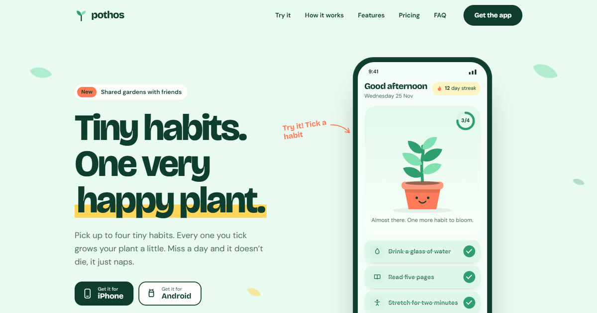

# Pothos

A landing page for a fictional habit-tracking app where your streak is a plant.
Playful and soft: mint, deep green, coral and butter yellow, big rounded corners.

**Live site:** https://minty-web.github.io/5/



## What's inside

- **Working demo in a phone mock-up**: tick the four habits and an SVG plant grows stem, leaves and finally a flower, with a progress ring, a smiling pot and a streak counter
- **Confetti burst** drawn on a `<canvas>` when the day is complete (skipped for reduced motion)
- **Weekly progress chart** in SVG whose bars spring up when scrolled into view
- **Testimonial carousel** with auto-advance, pause button, dots, swipe on touch screens and pause on hover or focus
- Pricing cards with a comparison table, FAQ, floating-leaf background and a mobile menu
- Greeting and date on the phone follow the visitor's clock

## Built with

Plain HTML, CSS and JavaScript. No frameworks, no build step.
Fonts: [Bricolage Grotesque](https://fonts.google.com/specimen/Bricolage+Grotesque) and [DM Sans](https://fonts.google.com/specimen/DM+Sans).

```
index.html    page structure, content and the plant SVG
styles.css    design tokens, layout and animations
script.js     habit demo, confetti, carousel, scroll reveals
favicon.svg   logo mark
```

## Run it locally

Open `index.html` in a browser, or serve the folder:

```bash
npx serve .
```

---

Pothos is a fictional app and isn't in any app store. Concept site designed and built by [minty-web](https://github.com/minty-web).
